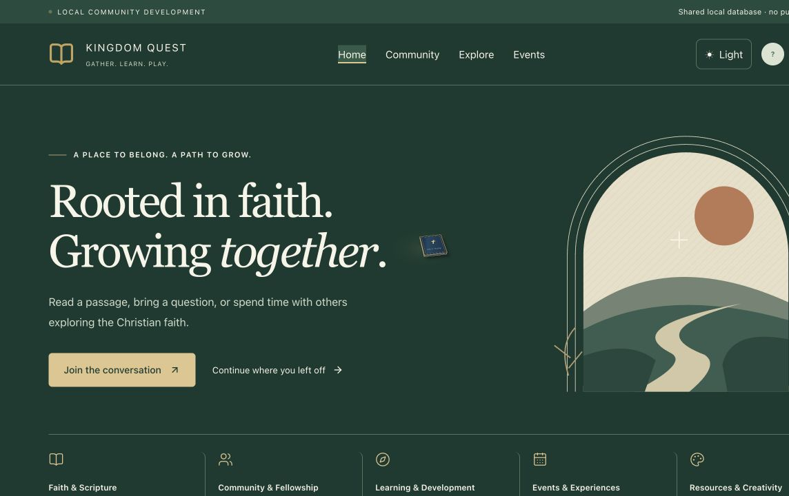

# Kingdom Quest — project showcase

Project overview • 5 November 2026

**Status: private development and testing.**

Kingdom Quest is a Christian community project developed by Gideon Adusei. It brings together community conversations, Bible reading and study, games, Faith Journey, books, podcasts, events and personal development. This showcase documents an existing application; it is not a deployed application or a claim of licensing approval.

## Project verification

Contact: kingdomquestsupport@gmail.com  
Existing earlier hosted version: https://kingdom-quest-bible-trivia.gadusei87.chatgpt.site/game/home/

The earlier hosted version requires ChatGPT sign-in and does not represent every feature in the private update. No reviewer credentials are included. This public repository provides a project overview and development screenshot for review.

## Application screenshots

These are unaltered screenshots from local acceptance on 3 November 2026, reused for this showcase. They are dated development evidence, not new captures.

### Community homepage

## Scope and confidentiality

This is a documentation-only showcase. It intentionally excludes application source, Git history, credentials, databases, real accounts, saved games, private prayers/notes, owner AI history, API keys and restricted publication datasets. The project has not been independently audited. No functionality is implied beyond the stated development status.

## Repository use

This repository contains only the reviewed showcase files. The application repository and its Git history are not included. No software/open-source license is granted by this showcase. Third-party names, Scripture excerpts and notices retain their respective rights; screenshots are supplied for project verification, not as a licensed Scripture dataset.
